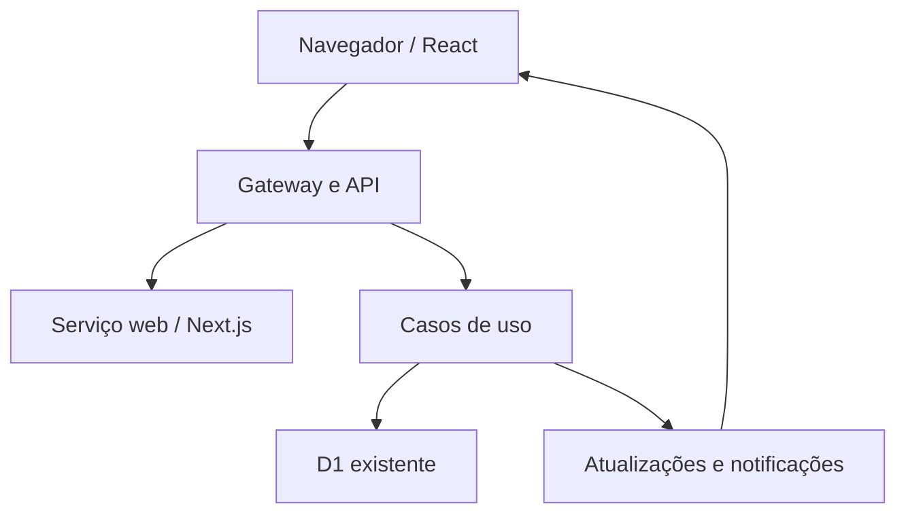
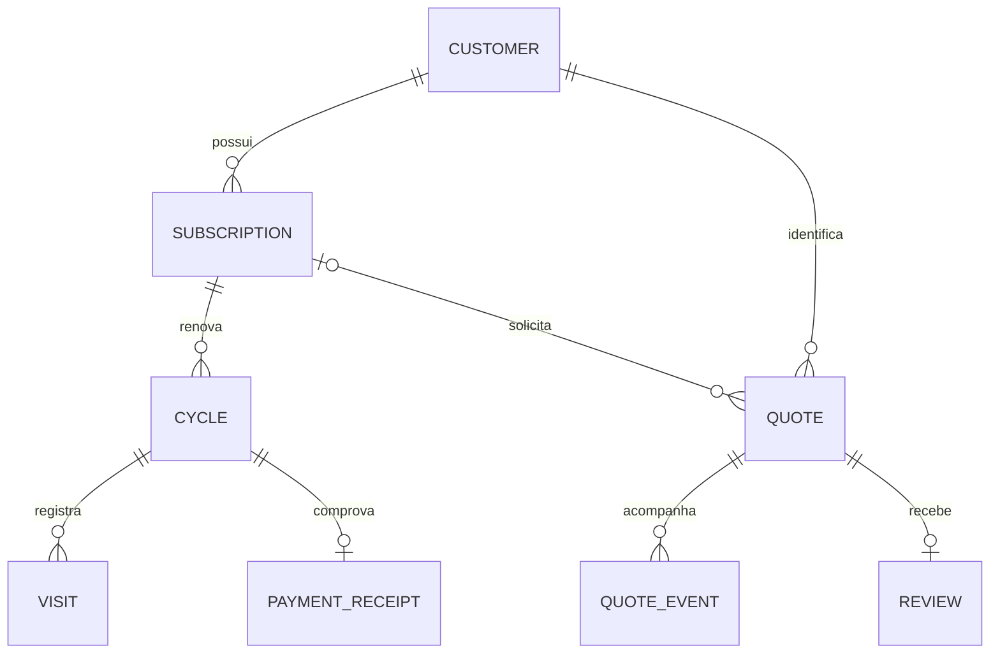

# Arquitetura Fine Form 4.0

## Serviços e limites

Há dois serviços com publicação independente: `fine-form-3-0` atende como gateway e API de negócio; `fine-form-web` entrega os arquivos produzidos pelo Next.js. Eles se comunicam pelo binding interno `WEB`, sem expor o serviço web à internet. O Durable Object `LiveUpdates` continua sendo o responsável pelas conexões de atualização, com o namespace anterior preservado.

Os domínios de pedidos, Care e pagamentos continuam na mesma API transacional porque o aceite e a reserva de créditos precisam ser atômicos. Eles têm módulos separados, contratos e validações próprios. Não são apresentados como microsserviços independentes: separar artificialmente cada tabela exigiria transações distribuídas e alteraria as garantias de saldo e pagamento.

## MVVM na interface

| Camada | Código | Regra |
| --- | --- | --- |
| View | `*View.tsx`, componentes de formulário, listas e editores | Renderiza JSX e encaminha ações do usuário. |
| ViewModel | `useBookingViewModel`, `useTrackingViewModel`, `useMembershipViewModel`, `useAdminSession`, `usePushViewModel` | Mantém estado, efeitos, validações e coordenação de serviços. |
| Model | `models/entities.ts`, `booking.model.ts`, `packages/domain` | Define contratos e regras puras. |
| Serviços | `services/api.ts`, `http.mjs`, `realtime.mjs`, `notifications.ts` | Encapsula endpoints, CSRF, timeout, cancelamento e WebSockets. |

Hooks encerram assinaturas, temporizadores e requisições no descarte. Recursos assíncronos cancelam respostas antigas para evitar que um carregamento anterior sobrescreva o atual. Atualizações ao vivo não substituem os campos de uma edição administrativa aberta. Reautenticação retoma a operação original, sem duplicar a gravação.

A animação do tentáculo é renderizada em React e possui um hook de ciclo de vida. A integração isolada de Web Animations controla a coreografia, foco, redução de movimento e cancelamento; ela não renderiza páginas ou formulários por strings HTML.

## API em camadas

`http/worker.mjs` cuida de requisição/resposta, origem, acesso por país, sessão, autorização e roteamento. `application/` implementa os casos de uso. `domain/` conserva invariantes e projeções. `infrastructure/` concentra persistência D1, sessão, criptografia, Web Push e atualização em tempo real. O catálogo compartilhado não depende de React, navegador ou Cloudflare.

A aplicação mantém os endpoints e os formatos já consumidos pelos links de clientes. As validações do servidor são decisivas. Campos de versão detectam conflitos de edição; tokens de envio e identificadores de operação dão idempotência. API e interface podem ser verificadas separadamente.

## Modelagem

| Agregado | Invariantes principais |
| --- | --- |
| Pedido | O cliente solicita; Mateus aceita. Transições válidas e versão conferida. |
| Assinatura | Um único veículo com placa conferida pessoalmente. |
| Ciclo | Intervalo sem sobreposição; fim exclusivo; pagamento manual; saldo não acumula. |
| Visita | Reserva ao aceitar; uso ao concluir; cancelamento libera saldo com registro. |
| Pagamento | Recibo preservado e valor do ciclo pago imutável. |
| Avaliação | Um atendimento entregue, uma avaliação, consentimento explícito e revogável. |
| Local | Endereço privado liberado por pedido; alteração do cadastro não reescreve locais já enviados. |

## Compilação e publicação

O Next.js App Router produz todas as rotas React em `apps/web/out`; o empacotamento copia o export para `dist`. A API recebe um manifesto de hashes CSP correspondente exatamente à compilação. CSS combina utilitários Tailwind e estilos da marca. Imagens e fontes continuam locais.

A exportação estática foi escolhida para preservar os endpoints, os links, o D1, o Durable Object e o endereço público existentes. O conteúdo operacional é carregado pela API. Não há requisito de Server Actions, SSR com dados privados ou troca de provedor. Informações públicas do fornecedor também têm uma alternativa sem JavaScript no gateway.
