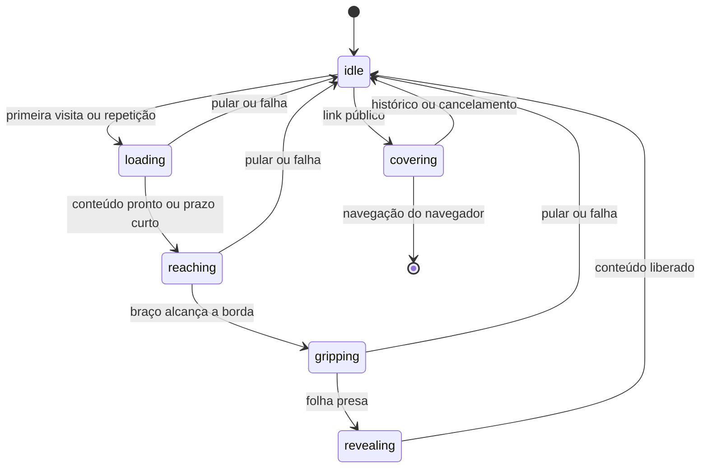

# Abertura Fine Form — folha e tentáculo

A primeira visita às páginas públicas mostra a marca, um carregamento circular e uma folha clara. Um tentáculo ciano entra pela direita, alcança a borda esquerda, agarra a folha e a puxa para revelar o conteúdo. O SVG é um desenho original da Fine Form, com ventosas e contorno preto.

A abertura aparece uma vez por sessão. **Rever abertura**, no rodapé, permite assisti-la novamente. **Pular abertura** e Escape liberam a página imediatamente. Links públicos entre a apresentação, atendimento e página de contatos usam uma transição curta da mesma família. Links para seções, contatos externos, downloads, abas novas, pedidos, assinaturas, avaliações e painel mantêm a navegação normal.

## Arquivos e responsabilidade

| Arquivo | Responsabilidade |
| --- | --- |
| `src/intro/config.mjs` | Rotas permitidas, tempos, chaves e política de navegação. |
| `src/intro/boot.mjs` | Pequena entrada no cabeçalho que escolhe a primeira pintura e garante saída se o módulo principal não chegar. |
| `src/intro/index.mjs` | Inicialização, preferência de movimento, botão de repetição e eventos do ciclo da página. |
| `src/intro/controller.mjs` | Sequência, prontidão do conteúdo, foco, inércia e encerramento. |
| `src/intro/animation-scope.mjs` | Animações e esperas canceláveis; nenhuma promessa de espera fica presa no encerramento. |
| `src/intro/navigation.mjs` | Transição de saída, passagem de sessão e navegação nativa do navegador. |
| `src/intro/tentacle.svg` | Desenho editável, cores, contorno, curvas, brilho e ventosas. |
| `src/intro/tentacle-layout.mjs` | Ajuste único à tela: mantém a proporção da ponta e alonga apenas o braço. |
| `src/intro/shell.html` | Única fonte da marcação do loader. |
| `src/intro/intro.css` | Composição, aparência, animações pequenas e regras responsivas. |
| `scripts/build-intro.mjs` | Compila as entradas e injeta a mesma abertura nas três páginas públicas. |
| `tests/intro.test.mjs` | Política, desenho responsivo, etapas, cancelamento, segurança de navegação e recuperação. |

Edite os arquivos em `src/intro/` e execute `npm run build`. O build gera `intro-boot.js`, `intro-loader.mjs` e `intro-loader.css` e atualiza os blocos entre os marcadores `ff:intro:*` em `dist/index.html`, `dist/atendimento/index.html` e `dist/links/index.html`. Não edite esses blocos gerados diretamente. O build pode ser repetido sem duplicar o loader.

## Sequência e ciclo de vida

`finish()` é o caminho único de liberação. Ele cancela animações e temporizadores, restaura apenas os atributos `inert` que adicionou, devolve o foco anterior e remove a trava de rolagem. `pagehide` também faz essa limpeza, deixando a página pronta para voltar pelo histórico. Cancelar uma saída pelo histórico impede uma navegação pendente de começar depois.

O estado de passagem guarda somente rota pública, parâmetros de navegação e horário por até quinze segundos. Não guarda dados de pedidos nem tokens privados. Não busca HTML por JavaScript, não troca o conteúdo da página como uma SPA e não altera URLs. Os módulos de pedidos, avaliações, notificações e administração continuam independentes.

## Desempenho e acesso

- Sem novas dependências de execução. SVG, CSS e Web Animations API nativos; sem vídeo, canvas, WebGL ou GIF.
- A geometria é calculada uma única vez por abertura, com limite de 22 ventosas no trecho extensível. O movimento usa transformações e opacidade; não recalcula curvas em cada quadro.
- A página real continua carregando por baixo. A espera considera apenas a primeira foto e a fonte principal, com limite de 800 ms. Conteúdo lazy, APIs e imagens abaixo da dobra não seguram o loader.
- A apresentação da marca tem um mínimo curto de 240 ms; alcance, pegada e saída somam aproximadamente 1,35 segundo. Não há porcentagem fictícia nem cronômetro fingindo representar transferência de bytes.
- Se algo trava, o controlador libera o conteúdo em até 3,6 segundos. Se o próprio módulo não carregar, o pequeno bootstrap libera a página em cinco segundos. Falhas de armazenamento também têm saída normal.
- A abertura inicial é omitida para movimento reduzido, animações pausadas, economia de dados, links profundos e restauração pelo histórico. Sem JavaScript, a marcação do loader fica oculta e a página mantém seu comportamento normal.
- A abertura não muda a posição de rolagem do documento. Durante a animação, o conteúdo fica inerte e Tab permanece no botão de pular; ao terminar, o foco anterior retorna.
- Os estilos da entrada principal ficam pausados enquanto a folha cobre o conteúdo e começam quando ela sai. A aba oculta cancela a abertura e evita efeitos que ninguém está vendo.

Tamanhos e testes de DOM verificam custo estático e comportamento. Não representam medição de FPS em um aparelho físico. O SVG foi renderizado para revisão das proporções de celular e desktop; isso não substitui a revisão da coreografia no navegador.

## Referências consultadas

- [Codrops — Morphing Page Transition](https://tympanus.net/codrops/2017/08/08/morphing-page-transition/): referência conceitual de folha que revela o conteúdo; não foi usado o código de morphing.
- [Codrops — Jump Loader](https://tympanus.net/codrops/2015/03/25/jump-loader-animation-svg-gsap/): referência de movimento lúdico em SVG; não usa GSAP ou plugins do exemplo.
- [web.dev — High-performance CSS animations](https://web.dev/articles/animations-guide): composição com transformações e opacidade.
- [MDN — Element.animate](https://developer.mozilla.org/en-US/docs/Web/API/Element/animate) e [inert](https://developer.mozilla.org/en-US/docs/Web/HTML/Reference/Global_attributes/inert): animações e controle temporário de interação.
